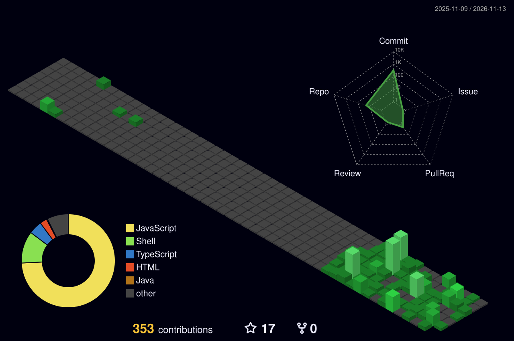

  

  

---

## 👨‍💻 About Me

I'm Narasimha, a CSE student working on web development and programming projects.

- 🌱 Currently learning React, Node.js, and Express.
- 🧠 Practicing Java and Data Structures & Algorithms.
- 🗄️ Working with databases and Linux.
- 🎬 Video editing and photography outside coding.
- 🚀 Interested in building useful real-world applications.

---

## ⚡ Current Focus

| Area | Current Focus |
|:---:|:---|
| 🌐 Web Development | React, Node.js, Express |
| 🧠 Problem Solving | Java, DSA, LeetCode |
| 🗄️ Databases | MySQL, SQLite |
| 🐧 Systems | Linux, Bash, Git |
| 🎬 Creative | DaVinci Resolve, Cinematic Editing |

---

## 🩸 Featured Project

### Blood Donation Management System

A full-stack application for managing blood donors, donation records, and blood requests.

 

  

---

## 📊 GitHub Analytics

  

---

## 🧊 Contribution Activity

<picture>
  <source media="(prefers-color-scheme: dark)" srcset="https://raw.githubusercontent.com/Narasimhasuraboina/Narasimhasuraboina/main/profile-3d-contrib/profile-night-green.svg"/>
  <source media="(prefers-color-scheme: light)" srcset="https://raw.githubusercontent.com/Narasimhasuraboina/Narasimhasuraboina/main/profile-3d-contrib/profile-green-animate.svg"/>
  
</picture>

---

## 🧩 LeetCode Journey

  

---

## 🛠️ Tech Stack

### Languages

### Frontend

### Backend & Databases

### Tools & Systems

### Creative Tools

🎬 DaVinci Resolve &nbsp;·&nbsp; 📷 Photography &nbsp;·&nbsp; 🎞️ Video Editing

---

## 🚀 Projects & Repositories

Explore my public repositories — from applications and experiments to coding practice.

<table>
  <tr>
    <td align="center" width="33%">
      <a href="https://github.com/Narasimhasuraboina/Blood-donation">
        <strong>🩸 Blood Donation</strong>
      </a>
       
      Blood Donation Management System
       
      
    </td>
    <td align="center" width="33%">
      <a href="https://github.com/Narasimhasuraboina/blood">
        <strong>🩸 Blood</strong>
      </a>
       
      Blood-related repository
       
      
    </td>
    <td align="center" width="33%">
      <a href="https://github.com/Narasimhasuraboina/Chatforge">
        <strong>💬 Chatforge</strong>
      </a>
       
      Chat application project
       
      
    </td>
  </tr>
  <tr>
    <td align="center">
      <a href="https://github.com/Narasimhasuraboina/Screen-ai">
        <strong>🤖 Screen-ai</strong>
      </a>
       
      AI browser assistant project
       
      
    </td>
    <td align="center">
      <a href="https://github.com/Narasimhasuraboina/spotify-to-apple">
        <strong>🎵 Spotify to Apple</strong>
      </a>
       
      Music library migration tool
       
      
    </td>
    <td align="center">
      <a href="https://github.com/Narasimhasuraboina/Travel">
        <strong>✈️ Travel</strong>
      </a>
       
      Travel project
       
      
    </td>
  </tr>
  <tr>
    <td align="center">
      <a href="https://github.com/Narasimhasuraboina/portfolio">
        <strong>🧑‍💻 Portfolio</strong>
      </a>
       
      Portfolio website
       
      
    </td>
    <td align="center">
      <a href="https://github.com/Narasimhasuraboina/project-phoenix">
        <strong>🔥 Project Phoenix</strong>
      </a>
       
      Project repository
       
      
    </td>
    <td align="center">
      <a href="https://github.com/Narasimhasuraboina/fully-vibe-coded">
        <strong>🧪 Fully Vibe Coded</strong>
      </a>
       
      Creative coding project
       
      
    </td>
  </tr>
</table>

### 🧰 Learning & Experiments

| Repository | Link |
|:---|:---:|
| ⚛️ **Namaste-react** — React learning | [View ↗](https://github.com/Narasimhasuraboina/Namaste-react) |
| ⚛️ **react** — React experiments | [View ↗](https://github.com/Narasimhasuraboina/react) |
| ☕ **java** — Java practice | [View ↗](https://github.com/Narasimhasuraboina/java) |
| 🌐 **html_project** — HTML project | [View ↗](https://github.com/Narasimhasuraboina/html_project) |
| 🧩 **play_ground** — Experiments and practice | [View ↗](https://github.com/Narasimhasuraboina/play_ground) |
| 🐚 **terminal** — Terminal-related project | [View ↗](https://github.com/Narasimhasuraboina/terminal) |
| 🐚 **cmd** — Command-line repository | [View ↗](https://github.com/Narasimhasuraboina/cmd) |
| 🎨 **visual** — Visual project | [View ↗](https://github.com/Narasimhasuraboina/visual) |

---

## 🎬 Beyond Code

I enjoy combining technology with creativity.

**Cinematic Editing · Photography · Visual Storytelling · Anime · Music**

 

*I don't just want to write code.*

*I want to build things worth remembering.*

---

## 🤝 Connect

  

**⚡ Code · Learn · Build · Create**

